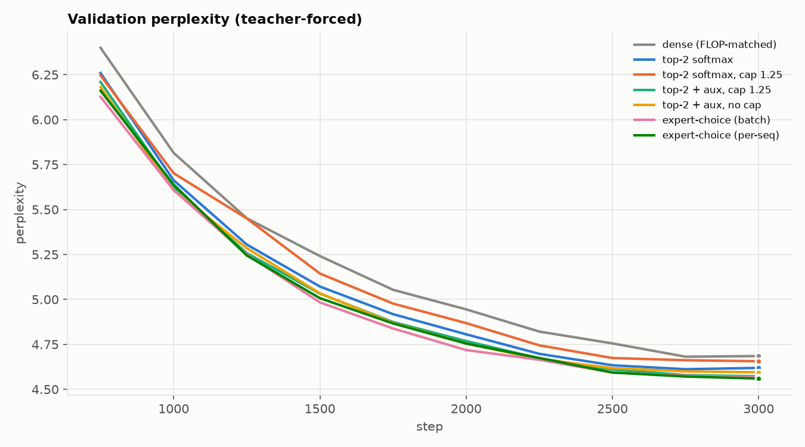
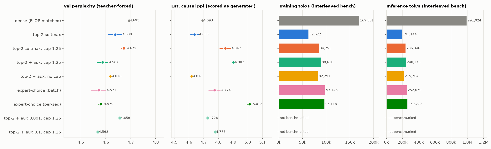
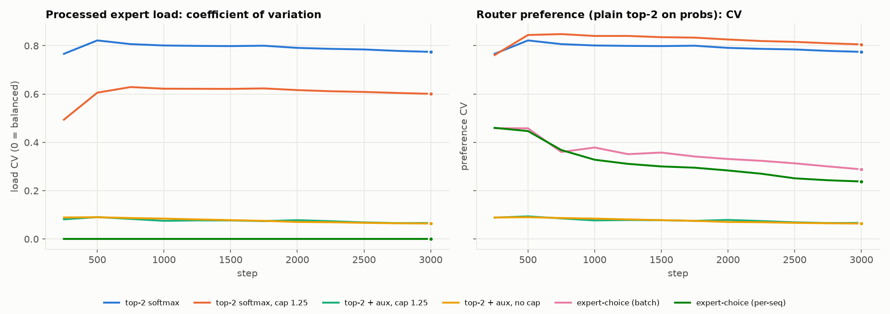
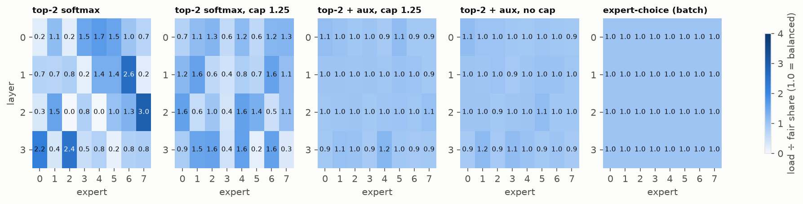
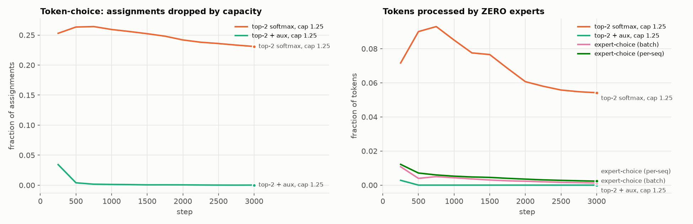
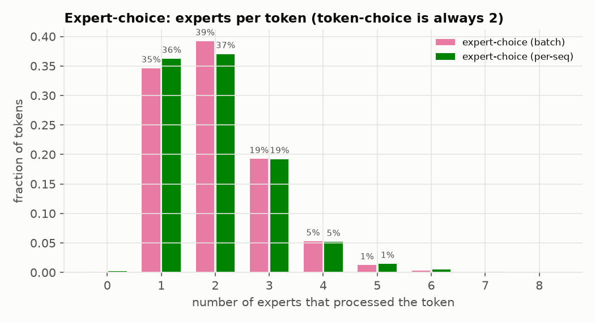

# 05-moe — Sparse Mixture-of-Experts, from scratch

A sparse MoE feed-forward layer written in plain PyTorch, with no MoE libraries. It's dropped into a small
decoder-only GPT and trained on character-level TinyShakespeare. Three routing strategies are compared:

| strategy | who chooses | gates | balancing mechanism |
|---|---|---|---|
| **top-k softmax** | each token picks its top-k experts | softmax probs of the chosen k, renormalized | none |
| **top-k + aux loss** | same | same | Switch load-balancing loss `E · Σ f_e · P_e` |
| **expert choice** (Zhou et al. 2022) | each expert picks its top-C tokens in a group | the token's softmax prob for that expert | perfect by construction |

Token-choice routers optionally take a **capacity factor**. Each expert accepts at most
`ceil(cf · N · k / E)` assignments and the overflow is dropped (the residual stream carries the token).

## Files

| file | what it is |
|---|---|
| `moe.py` | `TokenChoiceRouter`, `ExpertChoiceRouter`, `balance_loss`, `MoELayer` (route → dispatch → combine) |
| `model.py` | GPT: causal attention + FFN or MoE in every block; dense baseline is FLOP-matched |
| `data.py` | char-level TinyShakespeare, 90/10 split, fixed val windows |
| `train.py` | config-driven training; logs expert load, drops, entropy, tok/s; final causal evals |
| `configs/*.json` | `base.json` + one small override file per strategy |
| `ablate.py` | runs the whole grid (2 seeds per strategy + an aux-coefficient sweep), then `plots.py` |
| `plots.py` | figures in `figures/` + `figures/results.md` |
| `bench_throughput.py` | fair tok/s comparison: all strategies timed in interleaved rounds |
| `test_moe.py` | checks every router against a slow per-token reference, plus a causality test |

```bash
cd ~/Working/ml-from-scratch/05-moe
```

```bash
../04-diffusion/.venv/bin/python test_moe.py
```

```bash
../04-diffusion/.venv/bin/python train.py --config configs/topk_aux.json --set seed=1 --set steps=500
```

```bash
../04-diffusion/.venv/bin/python ablate.py && ../04-diffusion/.venv/bin/python bench_throughput.py && ../04-diffusion/.venv/bin/python plots.py
```

(The project reuses the `04-diffusion` venv: torch 2.13 + matplotlib.)

## How the layer works

```
x [B,T,d] ─flatten─► router: logits = W x  (W: d→E), probs = softmax(logits)
                         │
        token-choice: topk over experts per token     expert-choice: topk over tokens per expert
                         │                                         │
                 (tok, expert, slot, gate) for every assignment ◄──┘
                         │
      DISPATCH  buf[E, C+1, d][expert, slot] = x[tok]      (row C = trash slot for dropped)
      EXPERTS   y = W2 · gelu(W1 · buf + b1) + b2          (one batched matmul for all E experts)
      COMBINE   out[tok] += gate · y[expert, slot]          (index_add; unpicked tokens get 0)
```

The first version looped over experts on variable-length slices. On Apple MPS every new
shape triggers a kernel recompile, so token-choice ran about 25× slower than expert-choice.
Padding each expert to a fixed capacity buffer (what GShard and Switch do on TPUs)
fixed that. It also makes **imbalance cost wall-clock time**: without a capacity factor the
buffer is as long as the busiest expert's queue, just like the straggler expert on a real cluster.

**Capacity priority** is rank-major: every token's 1st choice is queued before anyone's 2nd
choice, so a top-2 pick never evicts somebody's top-1.

## Setup

4 layers, d_model 128, 4 heads, context 128, 65-char vocab. Each MoE layer has 8 experts (hidden 256), k = 2,
and expert-choice capacity factor 1.0 (on average 2 experts per token). The dense baseline uses FFN
hidden 512, the same FLOPs per token as 2 experts. Params: **2.40M total / 0.82M active per token**
for MoE and 0.82M for dense. 3000 steps × 32 × 128 tokens, AdamW 2e-3, cosine schedule. Two seeds per
strategy, plus a single-seed sweep of the aux coefficient (0.001 / 0.01 / 0.1).

### Metrics

- **val ppl (teacher-forced)**: the usual number, from 100 fixed val batches (410k tokens).
- **load CV**: std/mean of the tokens each expert actually processed (0 = balanced, √7 ≈ 2.65 =
  everything on one expert). `load_var` = CV² = Var(E·f_e) is also logged.
- **pref CV**: the same, but for where the router *wants* to send tokens (plain top-2 on its probs).
  For expert-choice the processed load is always perfectly flat, so this is its only imbalance signal.
- **dropped / zero-expert tokens**: assignments removed by capacity, and tokens that no expert processed.
- **causality probe**: replace the second half of every sequence with random characters and check
  whether any logit in the *first* half moves. A proper decoder moves 0%.
- **est. causal ppl**: how the model scores when every position is evaluated the way it is generated,
  one prefix at a time with no future and no other sequences in the group. We measure the paired
  AR/TF ratio on 8 × 128 held-out tokens (TF = teacher-forced) and rescale the big-sample val ppl by it. For
  strictly causal routers the ratio is exactly 1.

## Results



Mean over seeds (range in brackets). tok/s columns come from the interleaved benchmark (sweep runs weren't benchmarked).

| strategy | seeds | val ppl (teacher-forced) | est. causal ppl | AR − TF gap | load CV | pref CV | dropped | zero-expert tokens | leaks future? | train tok/s | infer tok/s |
|---|---|---|---|---|---|---|---|---|---|---|---|
| dense (FLOP-matched) | 2 | 4.693 (4.693–4.693) | 4.693 | +0.000 | 0.00 | 0.00 | 0.0% | 0.0% | 0% of positions | 169,301 | 991,024 |
| top-2 softmax | 2 | 4.638 (4.612–4.663) | 4.638 | -0.000 | 0.77 | 0.77 | 0.0% | 0.0% | 0% of positions | 62,622 | 193,144 |
| top-2 softmax, cap 1.25 | 2 | 4.672 (4.663–4.681) | 4.847 | +0.165 | 0.60 | 0.81 | 23.1% | 5.4% | 96% of positions | 84,253 | 236,346 |
| top-2 + aux, cap 1.25 | 2 | 4.587 (4.565–4.609) | 4.902 | +0.293 | 0.07 | 0.07 | 0.0% | 0.0% | 96% of positions | 88,610 | 240,173 |
| top-2 + aux, no cap | 2 | 4.618 (4.615–4.621) | 4.618 | +0.000 | 0.06 | 0.06 | 0.0% | 0.0% | 0% of positions | 82,291 | 215,704 |
| expert-choice (batch) | 2 | 4.571 (4.542–4.600) | 4.774 | +0.191 | 0.00 | 0.29 | 0.0% | 0.1% | 100% of positions | 97,746 | 252,079 |
| expert-choice (per-seq) | 2 | 4.579 (4.570–4.589) | 5.012 | +0.401 | 0.00 | 0.24 | 0.0% | 0.2% | 100% of positions | 96,118 | 259,277 |
| top-2 + aux 0.001, cap 1.25 | 1 | 4.656 (4.656–4.656) | 4.726 | +0.065 | 0.25 | 0.32 | 5.0% | 0.0% | 95% of positions | – | – |
| top-2 + aux 0.1, cap 1.25 | 1 | 4.568 (4.568–4.568) | 4.778 | +0.194 | 0.01 | 0.01 | 0.0% | 0.0% | 91% of positions | – | – |











### Headline

**On teacher-forced perplexity every MoE beats the dense model, and the "best" ones are expert-choice
and top-2 + aux with capacity. Once you score them the way a decoder is actually used, every router
whose output depends on other tokens in the batch falls *behind* dense.** The only routers that
keep their advantage are the strictly causal ones, token-choice *without* capacity:
top-2 + aux (4.618) and plain top-2 softmax (4.638), against dense at 4.693.

## Where each strategy fails

### Top-k softmax, no aux loss: imbalance and dead experts

- Nothing forces balance, so the router quickly settles on favorites (load CV ≈ 0.77, flat from step ~500).
  The heatmap shows experts with **0.0×** their fair share (layer 2, experts 2 and 4), which are dead
  parameters. Others get 2.4–3.0×.
- It didn't fully collapse to one expert at this scale. Renormalized top-2 gates plus
  random init keep most experts in use, but every layer has 2–3 experts at ≤0.3× their fair share.
- Quality is fine (4.638, causal) because nothing is dropped. The cost is **efficiency**: the padded buffer
  is as long as the busiest expert, so it's the slowest MoE variant per token, and the unused experts are wasted memory.
- **Adding a capacity factor makes it strictly worse.** With imbalance plus cap 1.25, 23% of assignments are
  dropped and 5.4% of tokens get *no* expert. TF ppl falls to roughly dense (4.672), and it varies a lot
  by seed: seed 1 dropped 30% and left 10% of tokens unprocessed.

### Top-k + aux loss: the balance fix works; the capacity factor is the problem

- The Switch loss does its job: load CV falls to 0.06–0.07 and stays there, and drops at the training batch
  size go to ~0%. The aux sweep shows the expected dial. At 0.001 it's too weak (CV 0.25, 5% dropped, ppl 4.656);
  0.01 and 0.1 both balance well, and at this scale even 0.1 didn't hurt teacher-forced ppl.
- **Capacity makes the layer non-causal.** Whether a token's assignment survives depends on its queue
  position, and that depends on every assignment processed before it in the flattened batch. That includes
  other sequences and, because of rank-major priority, *later* tokens' first choices. The causality
  probe moves 91–96% of first-half positions for every capped run.
- The damage shows at generation time. When the group is one short prefix, `C = ceil(1.25·t·2/8)` is
  tiny and neighbouring characters prefer the same experts, so drops come back exactly where the model never saw them in training.
  AR scoring is +0.29 ppl worse (est. 4.90, worse than dense). Without the cap, the same router is exactly causal
  (gap 0.000) and is the best honest model here.
- So: **for a decoder, use the aux loss to balance, and treat the capacity factor as a systems knob
  you must keep identical between training and serving.** Don't treat it as a free regularizer.

### Expert choice: perfect balance, broken causality

- Load is perfectly balanced by construction (CV 0.00, nothing dropped), and its teacher-forced
  ppl (4.571) is among the best. The router still has preferences (pref CV 0.24–0.29); expert-choice just doesn't let them
  turn into imbalance.
- **Per-token compute is uneven** (coverage plot). About 35% of tokens get only 1 expert, 19% get 3, 5% get 4,
  and 0.1–0.2% get none. Token-choice always gives exactly 2.
- **It is fundamentally non-causal for a decoder.** Expert e keeps the top-C tokens of a group *ranked
  against each other*, so whether token t is processed depends on how strongly the expert likes tokens
  t+1, t+2, … That is information from the future. The probe changes **100%** of first-half positions.
  At generation time the future doesn't exist, so the routing the model trained with can't be reproduced.
  Estimated causal ppl is 4.774 (batch groups) and **5.012** (per-sequence groups), both worse than dense.
- Per-sequence grouping is *worse* than batch grouping. Each expert picks its 32 of 128 tokens from the
  *same* sequence, so its selection is directly conditioned on that sequence's future. In batch mode
  the competition is diluted across 32 unrelated sequences, which leaks less about any one sequence.
- Expert choice was designed for encoders and large-group training. In a decoder it needs a causal
  fix: route on past-only statistics, use an auxiliary token-choice predictor at inference (the
  paper's own suggestion for decoding), or restrict it to the encoder side.

### Dense baseline

It has the lowest teacher-forced quality (4.693) but is far faster at this scale (see throughput) and
causal by construction. At 0.8M active parameters, MoE adds 3× the parameters for a ~1–2% ppl gain.
That makes sense: TinyShakespeare is small enough that capacity isn't the bottleneck.

## Throughput

Median of 15 interleaved rounds after 600 warm-up training steps per model, so the routers have developed
their real imbalance (`bench_throughput.py`, Apple-silicon MPS). Another GPU job was running during the
benchmark too. Interleaving spreads that load evenly, but absolute numbers are lower than an idle machine would give.

| strategy | train tok/s | inference tok/s | vs best MoE (train) |
|---|---|---|---|
| dense | 169k | 991k | 1.73× |
| expert-choice (batch) | **98k** | 252k | 1.00× |
| expert-choice (per-seq) | 96k | **259k** | 0.98× |
| top-2 + aux, cap 1.25 | 89k | 240k | 0.91× |
| top-2 softmax, cap 1.25 | 84k | 236k | 0.86× |
| top-2 + aux, no cap | 82k | 216k | 0.84× |
| top-2 softmax | **63k** | 193k | 0.64× |

- **Imbalance costs wall-clock.** Plain top-2 softmax is the slowest by a wide margin (−36% vs expert-choice).
  Its buffer is as long as the busiest expert's queue (about 3× fair share), so most of the batched matmul is padding.
- **Expert-choice is the fastest MoE.** It has fixed shapes, no queue-position cumsum, and no GPU→CPU sync to size the buffer.
  That is the systems case the paper makes, and it holds here.
- **Capacity buys speed and costs correctness.** With the aux loss the cap gains about 8% (89k vs 82k) by fixing
  the buffer size. Given the causality cost above, that is a bad trade for a decoder at this scale.
- **Dense is 1.7× (train) to 3.9× (inference) faster than any MoE.** At d_model 128 the router, scatter/gather
  and padding overheads dominate the tiny expert matmuls. MoE pays off when experts are large enough for
  their FLOPs to dominate, and when experts sit on different devices. Neither is true for a 2.4M-param model on one GPU.

## Caveats

- Tiny scale: 2.4M parameters, a 1M-character corpus, 3000 steps. Absolute ppl differences between
  routers are 1–3%, and the two-seed ranges overlap for several pairs. The *causality* findings are
  structural and don't depend on scale. The perplexity ranking might change at scale.
- "est. causal ppl" uses a single-stream, batch-1 deployment as the definition of "how it is used". A
  server that batches many users' current tokens would see yet another group composition (and other
  users' tokens would influence yours), which is another argument against batch-dependent routing.
- Another GPU workload was running on the machine during part of the grid, so the tok/s values logged by
  `train.py` are noisy. Use the interleaved benchmark numbers.
